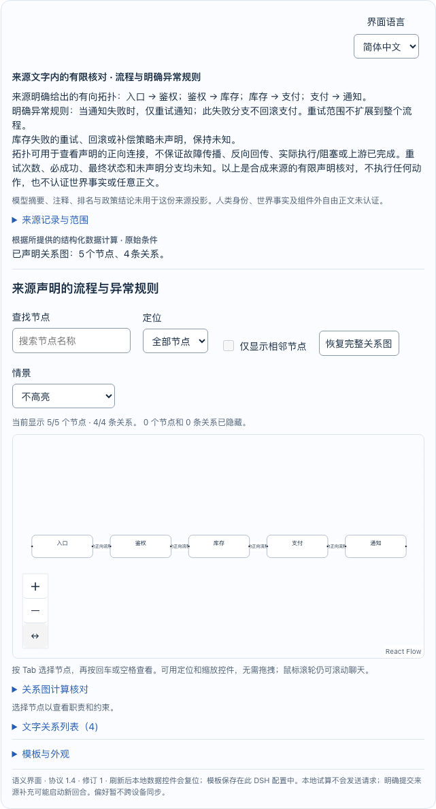
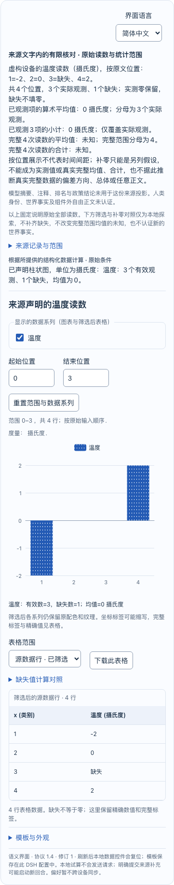

# 原始六题的可运行来源参考

现在可以把原六题的完整来源，经现有有限解析器构造成参考载荷，送入正常 DSH Native 会话，查看组件、调整局部假设并刷新恢复。也可以指定自己的文本文件或 JSON 字段。入口是 [dsh-source-reference.mjs](../examples/dsh-source-reference.mjs)，[完整证据](evidence/original-case-reference.json)单列实际运行范围。

这里的载荷由程序依据来源构造。原模型回答、原工具实参和首次失败均未修改，原六题仍为 **0通过 / 6失败 / 18请求**。这次没有新模型回答，不把新参考计为旧自然题通过。

## 启动和使用

在本仓库安装开发依赖后，使用已经下载并核对过的 preview.26 运行包和同版 manifest：

```sh
pnpm install --frozen-lockfile
node examples/dsh-source-reference.mjs \
  --archive artifacts/releases/0.1.0-preview.26/whytan-dsh-semantic-ui-0.1.0-preview.26.tgz \
  --manifest artifacts/releases/0.1.0-preview.26/package-manifest.json \
  --open
```

运行包和 manifest 可从 [preview.26 Release](https://github.com/WhyTan00/dsh-semantic-ui/releases/tag/v0.1.0-preview.26)取得；命令不会自动下载。它在新建的私有目录中正常安装插件，启动本次独有的 DSH Native 和本机确定性工具夹具。默认打开六个独立会话，界面语言默认中文。`--open` 使用 macOS Edge；其他环境可自行打开终端提示的私有地址。按 Ctrl+C 关闭本次服务。不会替换用户现有实例。

只看一道原题可加 `--case D1`。换成自己的文件时，用 `--source-file`，例如选取公开原 D2 记录中的问题字段：

```sh
node examples/dsh-source-reference.mjs \
  --archive artifacts/releases/0.1.0-preview.26/whytan-dsh-semantic-ui-0.1.0-preview.26.tgz \
  --manifest artifacts/releases/0.1.0-preview.26/package-manifest.json \
  --source-file docs/evidence/natural/r9-D2.json \
  --source-json-pointer /question
```

普通文本文件不加 `--source-json-pointer`。可用 `--source-kind` 显式选择 `workflow-zh`、`permissions-zh`、`decision-zh`、`capacity-zh` 或 `observations-zh`；默认尝试五种现有有限语法，只有唯一完整匹配才构造组件。不支持的文字明确返回“不支持”，不强行作图。文件选择和原题选择不能混用。

加 `--check` 可运行有限的自动交互检查，结束后清理本次服务。`--output` 指向一个尚不存在的私有运行目录。浏览器自动检查需要已安装 Playwright Chromium。这里只覆盖本机 Node/DSH 的普通入口；不要求或修改 Codex 全局模型配置、路由或信任设置。

## 原六题在当前核心的结果

| 原题 | 原始问题暴露的缺口 | 当前核对与新参考 |
|---|---|---|
| A2 流程异常 | 图的正向边正确，但原实参未声明完整异常规则；原正文增加执行状态和反向影响推断 | 当前来源核对拒绝缺失策略。参考保留四条正向边、通知失败仅重试通知且不回滚支付；库存策略和执行保证未知 |
| A3 访问边界 | 原节点用 `Client` 替代来源字面“客户端”，并在正文扩大入口、独立性等结论 | 当前绑定拒绝未核别名。参考保留五条直接访问、只读/读写、主体局部的“只能”与禁止关系，不增加反向边 |
| D1 方案维护 | 原载荷补齐未给的反面、为未知价格增加币种，并把维护负担当能力支持 | 旧视图仍可读；新交付拒绝缺少角色的声明。显式审阅坐标下另能检出来源值和关系方向错误。参考使用“要求资源可用”，未给余力与反面保持未知 |
| D2 容量取舍 | 原载荷混合部署和维护，预留控件只有偏好效果，正文却承诺硬性容量切换 | 旧视图仍可读；新交付拒绝未声明依赖的控件，来源核对另拒绝不支持的策略。参考只有一个数值硬需求；80GB两者通过，局部假设300GB时A不满足、B通过 |
| N2 缺失读数 | 原回答使用另一插件，均值正确但附加普遍化解释错误 | 当前完整来源可解析为 `[-2, 0, null, 2]`。参考保留缺失：已观测均值/小计为0、分母3；完整四次均值/合计未知；另列补零假设的数值仍为0 |
| T2 简短解释 | 原回答没有工具调用，正文把补零影响一概说成向下 | 没有可构造的完整数值来源，不生成组件；N2提供“数值相同”的反例。原自由正文仍未认证 |

四个旧 Semantic UI 载荷在实际正常 Native 交付时均被当前守卫拒绝，没有先修改旧载荷再称其通过。D1/D2离线诊断中用于定位字段的坐标是审阅者显式提供的，原模型没有提供这些映射。[基线原件](evidence/original-case-reference/current-core-baseline.json)保留这一分层；对应坐标在[合同测试](../tests/source-reference-contracts.mjs)中可查看。

本次没有发现这六个原输入在当前核心仍可复现的错误比较，因此没有修改运行核心、放松校验或重发运行包。新增的是通用来源构造器和普通采用入口：字段、映射与角色来自已有解析结果，题号只用于选择公开例子，不参与放行判定。

## 实际交互与模板

正常 Native 的六个输入分别持久化为独立会话。五个支持的来源完成核对、正常 render 与 checkpoint；T2只有文字。局部交互实际改变结果：两张图分别从5/6个节点聚焦到2个；D1把维护余力由未知改为否，虚拟机不满足而托管平台仍未知；D2把80改为300；N2从第二个位置开始筛选，已观测均值由0变为1、有效数由3变为2。

这些局部变化没有新增工具请求、修改来源或 checkpoint；刷新恢复原始条件。宿主按既有合同重建有来源的展示说明，参考输入与最终 checkpoint 的全部差异保存在[实际 Native 回执](evidence/original-case-reference/native.json)中。

模板仍只保存形状和语义角色，不带旧方案、读数或输入初值。旧错误形状不能静默当作新模板；即使新载荷匹配模板，改变来源数值仍须重新核对，不能由“模板匹配”推导“来源匹配”。

## 本次验证范围

- 10项离线合同通过，其中7项针对本入口及原题语义，3项保留已保存模型回放的来源合同。[测试输出](evidence/original-case-reference/unit.txt)可查。
- 原六题检查：6个确定性夹具回合、25次本机 HTTP 请求，5个组件、4个旧载荷拒绝、5次有效局部交互、页面错误0。
- 自带文件入口默认 serve：1个确定性夹具回合、4次本机请求，实际图形组件就绪，Ctrl+C后自有服务关闭。
- 合计7个夹具回合、29次本机请求、**0次真实模型启动**。不是“0个Agent回合”，也不是原自然题的模型复测。
- 正常 `dsh plugin add` 安装既有26归档，五个运行入口与 manifest 对应；本次没有重新核验全部388文件，没有新运行版本、Release或完整CI矩阵。

首轮截图在改宽后过早拍摄，A2部分节点仍处于适配动画。原图保留为[截图勘误](evidence/original-case-reference/first-capture-A2-640.png)。随后仅重开既有保存会话，等待所有节点进入图框及图表表面完成缩放，得到640/360px共10张稳定截图；没有新输入或夹具请求，checkpoint事件逐字相同。只读取证还保留了侧栏补页和边框宽度断言的两次失败；详见[截图与几何回执](evidence/original-case-reference/settled-capture.json)。最终入口使用修正后的等待代码，首轮交互运行不能冒称已执行后补的截图断言。





来源身份、世界事实和任意模型正文均未认证。本次没有新增PTC、Linux、真机或Codex主界面图形验收，也没有扩大GenUI替代范围。新入口把来源/展示/假设/历史分层用于实际操作，不代表此前研究的35个项目已全部采用。
