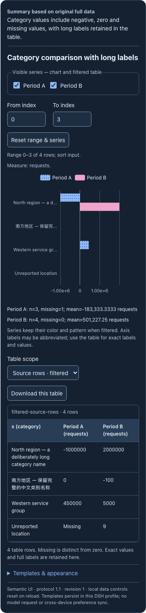
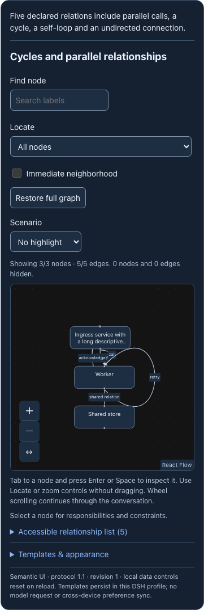
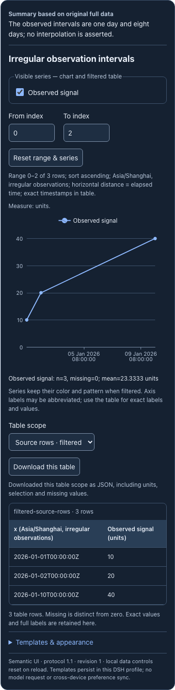

# 可交互可视化质量改进（preview.7）

本轮针对已有三组件与 line/bar/histogram 的实际缺陷改进。没有扩充为任意图表生成器，也不把页面正常、schema 通过或单次模型答对称为“完美”。

## 已实现

| 问题 | 实现 | 验证方法 |
|---|---|---|
| 不等时间间隔被等距绘制 | UTC epoch 位置 + 声明时区标签；null 保留缺口 | 1 天与 8 天区段的实际 SVG 距离比例应为 1:8；数据和时间戳不改写 |
| 长类别、正负数、窄屏刻度 | 长类别横向柱图，保留 0/null/负数，刻度可简写，完整标签与精确值进入表格 | 640/360px、中文长标签、全缺失/全零、导出一致性 |
| 只靠颜色辨识系列 | 稳定系列颜色、点形/线型及柱纹理；过滤不重新编号 | 隐藏一个系列后其它系列编码不变；深浅主题 |
| 图、表和下载容易不同步 | 一个纯函数计算三者；JSON 明确单位、范围、系列、分母与来源 | 过滤/全量两种范围；预聚合数据不冒充原始观测；比例分母按所选有效样本 |
| 图节点可聚焦却不能打开详情 | React Flow 原生选中事件驱动详情和 Locate | Enter/Space 选择、Escape 清空、非拖拽定位 |
| 平行边/回边/自环重叠，窄屏布局错位 | 独立路径、方向适配，按容器与几何重算视口并包含边界 | 5 条关系、横纵切换、360px 全节点/路径可见；关系表提供完整文本 |
| 比较结果容易混淆规则与事实 | 区分 proposed/declared policy；新增条件与维度重置；回执明示未验证事实 | 规则求值与重置；自然问题单独评审 |

时间数值位置、缺失规则、统计与导出由应用确定。模型提供的说明文字没有独立验证；下载保留模型提交的数据，不等于证明数据来自真实世界。图表控件和模板预览不发模型请求，刷新后临时探索控件复位。

## 公开来源与采用边界

- [Observable Plot temporal scales](https://observablehq.com/plot/features/scales)：连续时间尺度的表达原则，独立实现到现有 ECharts renderer；没有引入 Plot 运行依赖。
- [ECharts ARIA](https://echarts.apache.org/handbook/en/best-practices/aria/)：模块注册、动态描述与 decal。补充纹理不能替代完整数据表，也没有宣称完成屏幕阅读器人工验收。
- [React Flow accessibility](https://reactflow.dev/learn/advanced-use/accessibility)：使用公开选择/视口 API、可执行的键盘说明；布局遵循节点实际方向。
- [Unovis theming](https://unovis.dev/docs/guides/theming/)：稳定颜色映射和 pattern 的第二种区分方式。固定源码为 Apache-2.0；仅吸收模式，没有复制组件或新增依赖。
- [Visa Chart Components](https://design.visa.com/data-visualization/)：等价表格、长文本描述与操作说明。固定根许可证为 MIT；本项目保持自己的语义合同与表格实现。

固定 commit、文件 SHA、许可证和具体 adopted/reference 状态见 [35 个项目/139 份来源清单](research/PROJECTS.md)。研究清单不是已集成库数量，不把上游源码 HEAD 版本当稳定发行版。

## 证据边界

58 项单元测试通过；Native/PTC 各完成原四样例、模板流程和五个质量样例，页面错误与 360px 横向溢出为 0。两种模式的实际时间区段距离比均约 0.125。记录见 [质量证据](evidence/quality.json)。确定性夹具通过真实 DSH Native/PTC，只证明宿主、交互和计算链路。冻结自然题另保留每个首次模型输入、工具结果、正文与错误，不能用夹具替代自然表达选择。

仍未实现 RequestForm 回传/草稿、散点/地图/3D、自由页面编排；这些目录外任务按真实可用能力选用 GenUI 或其它工具。GenUI 历史由自己的 renderer 负责，不迁移或改写。大型复杂图的可读性、不同屏幕阅读器和真实手机仍需专项验证。

## 真实宿主截图（确定性夹具）

