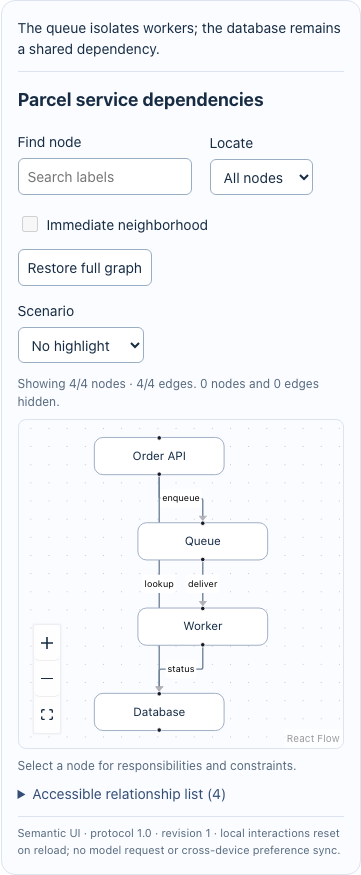
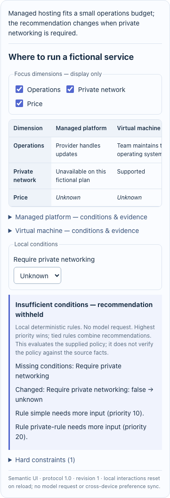
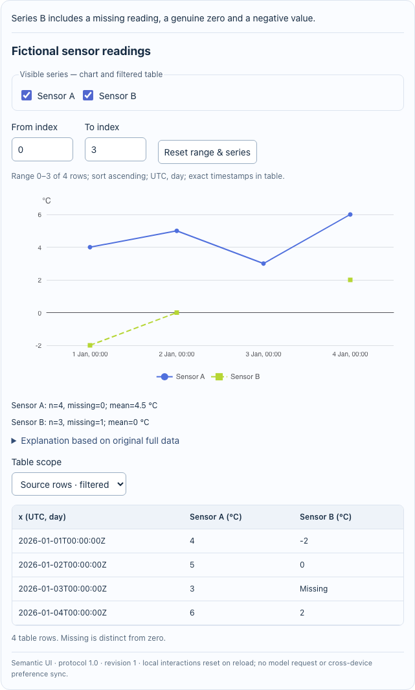
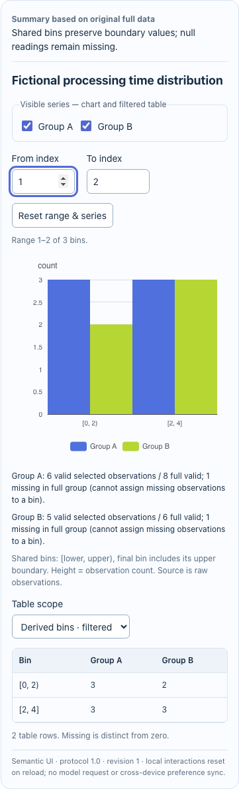

# 验证证据与未通过项

preview.27最终接受：39项定向单元（8文件）与类型/发行隔离检查通过，源码/tag13054fcb6e98488a1f9029277daa7c2385f20b3d，归档03f962eda24e915f430e0d6660009eb21e7f9b3a0b92d67ef94685e4386c63d1，396文件安装前全核。本机/Linux Native/PTC每组2场景检出全缺失与筛选后缺失假设0、原观测和真实完整未知、填零冒源拒绝、JSON null、空范围/全量/刷新，16张640/360实际图与pageerror0；CI41186746024成功、四构建文件同字节。普通来源入口serve实际采用并清理。四发行资产匿名HTTPS200且同本机/Linux字节，另按[分层回执](evidence/zero-fill-chart.json)记录；11夹具回合0真实模型，原自然0/6/18和旧D首败不改。开发Native截图早于测试问题尾句/工具回执断言的补充，不冒最终归档证据；下面开发段保留原范围。

preview.27的[图表全缺失假设修复](ZERO-FILL-CHART.zh-CN.md)先以独立数学0复现2个失败，再由现有核心统计器计算独立假设副本；开发33项定向检查通过，原观测/完整值、空范围、溢出和null导出分开保护。新运行归档和宿主/发行接受见[分层回执](evidence/zero-fill-chart.json)，不以开发检查或旧CLI成功替代，不升级原六题自然结果。

2026-10-31原六题定向采用：[来源参考入口](ORIGINAL-CASE-REFERENCE.zh-CN.md)在既有26归档正常Native验证5个支持来源/4个旧载荷拒绝/5个有效局部交互与刷新，T2无组件。10项离线合同通过；六题检查及自带文件serve共7个确定性夹具回合、29本机POST、0真实模型，未重发运行包或重跑旧矩阵。后补截图只读重开既有会话，10张640/360稳定图与checkpoint相同；首轮截图过早和两次采集断言失败单列。现有六输入未发现可复现的核心错误比较，来源未知/模板角色/容量硬条件仍严格；原六自然失败、自由正文和未覆盖平台边界不升级，见[分层证据](evidence/original-case-reference.json)。

24已[公开预发布](https://github.com/WhyTan00/dsh-semantic-ui/releases/tag/v0.1.0-preview.24)：源/tag780328056294060d79d7f89372ab87b312a982fb，运行ccd2b7890292eee150d8fb9c3ea800d75e0f69ddcd4c72b532eee0bdee28fb70，382文件最终归档正常安装；19项4文件、macOS/Linux Native/PTC各1诊断序列、普通CLI错误标签拒绝/明确修正交付与刷新通过。CI40500985324成功、四匿名HTTP200资产与本机/Linux同字节，见[修复接受](evidence/capacity-contract.json)。[两个新引导观察](CODEX-CAPACITY-OBSERVATION.zh-CN.md)共2/2：两raw有限met，但首题23无view matched，第二题24当前view首次matched，假设初值不能冒原来源的拒绝保留；backend请求数unknown，不当同题因果基准或原六题通过。

preview.23已[公开预发布](https://github.com/WhyTan00/dsh-semantic-ui/releases/tag/v0.1.0-preview.23)：源/tag6393ec7277beb36e81ac679ebd3ae43966efe56d，运行SHA8f4492c7242c99f1daf884be1af38b1275f8eeac0164b2fb96309023117421c8，379文件最终归档先逐字节核再正常安装；macOS/Linux Native/PTC各6例、真实300/550本地容量变化、无效/空/非有限/0、原始需求刷新及旧Decision1.2通过，pageerror0。普通CLI正确请求delivered、300冒当前80 withheld，两层wire相同、0turn/start。55项8文件+16离线检查与精度窄回归通过，CI40491658156成功，四份匿名HTTPS200资产与本机/Linux同字节。通用安装摘要曾误标full/all-four，按真实案例更正范围并保留原件；摘要标签修正为冻结后的验证代码，未改包，不冒原Linux已跑该修订。本段新模型0，原D2/raw、0/6/18、A2及G/H保持；见[最终分层接受](evidence/source-capacity.json)。

附加只读截图验收复用同一23安装重开Native/PTC历史，640/360容器无根溢出，完整组件处于视口内；0新夹具推理/模型，任务私有patch已还原、进程/端口关闭。首次被宿主固定栏遮挡的截图保留；扩大截图视口和安装摘要标签的测试修订均在源码冻结后，不改运行包，也不冒原Linux已执行这两项修订。见[截图与清理记录](evidence/source-capacity/settled-capture.json)。

后续[G/H独立观察](CODEX-WORKFLOW-OBSERVATION.zh-CN.md)单列于[新证据](evidence/workflow-observation.json)：原22包/技能/客户端不改，G关键规则正确但附加边界覆盖partial；H未知策略与首次新图来源比较met/matched。模型语义调用分别1/4，内置发现各2，宿主显式调用各3；原文没有用宿主答案替换。2/2新观察均completed、无重试，backend请求数未知，sourceFacts/identity/freeProse认证false。两层参数/structured response核对、stdout与宿主文本、四次进程终态/临时根清理通过。无新runtime、发行或旧矩阵重演；以下22发行接受的0模型与旧自然0/6/18不变。

preview.22已[公开预发布](https://github.com/WhyTan00/dsh-semantic-ui/releases/tag/v0.1.0-preview.22)：源/tag a0ca980884adbc21d476ffcf92133e3305df67cc，运行SHA ed0187cc5089c9f3c84c3f4eb3d2063856428e2db71f730fe53a170776aadb2e。完整workflow-zh将四拓扑与通知失败的仅重试通知/不回滚支付分别核对，库存策略和未给执行保证保持未知。52项8文件+10伴随离线检查通过；最终371文件实际安装先全核，macOS/Linux Native/PTC各6例、旧1.0图/正常消息/刷新历史/360px通过，pageerror0。普通--answer正例delivered、错误支付回滚withheld，双层wire一致，2appserver exit0/tap终态，0turn/start/global配置摘要不变。CI40479181323 success，四资产Mac/Linux/匿名HTTPS200同字节。源后补的几何等待验证及只读侧栏补页另核，稳定后五节点全在图框内；不冒原Linux新断言或改包。首次旧receipt选择失败和3次附加侧栏诊断保留，独立预期未改。原A2 raw/共享payment→notify勘误/0pass6fail18requests保持，sourceFacts/identity/freeProse认证false，新模型0。见[最终分层接受](evidence/source-workflow.json)；以下候选段保留冻结前范围，不当最终归档接受。

冻结前开发记录（22）：[完整异常规则合同](SOURCE-WORKFLOW.zh-CN.md)区分给定规则、纯拓扑、typed矛盾/未知与原始模型正文。52项/8文件、10伴随离线检查和开发Native/PTC各6例通过；最终归档安装/Linux/实际普通答复与匿名下载另记。原0/6/18和A2首次错误不回写，当前没有新增真实模型。

preview.21已[公开预发布](https://github.com/WhyTan00/dsh-semantic-ui/releases/tag/v0.1.0-preview.21)，冻结源码2f2cb1908655d4cf2d554b74b9356472339fb44b；运行SHA e0779f6ba59532aa2d003a0645fe84a8b8e17d71a13aa2d87c9ab6086602d46a。最终365文件先逐字节核后正常安装，macOS/Linux Native/PTC的冷只读、明确新来源、原ID与历史恢复通过。正常SourceUpdatePanel每组注入unknown/withheld无ID结果，原ID仍显示、随后三次请求仅同ID status，无offer/submit/新提交ID；错误态不复用旧采用字段，恢复真实原收据后才显示采用。39项定向合同通过、CI40472008667成功，四资产与本机/Linux/匿名HTTPS200同字节；见[最终接受](evidence/cold-source-update.json)。20公开后代码复查发现的原ID界面缺口及原资产保持，21是独立版本。新推理0，0520前段2/2不重置；原0/6/18、身份/世界/自由正文未核保持。以下候选段是冻结前开发证据，不替代本段最终归档接受。

冻结前开发记录（21）：[冷会话验证范围](COLD-SOURCE-UPDATE.zh-CN.md)区分开发构建、最终归档和宿主导航行为。39项定向合同与开发Native/PTC重启/冷读/明确补充/原ID恢复通过，0真实推理；最终归档、Linux与匿名下载尚未由这些源码检查证明。旧19及更早矩阵保留原版本。

状态：preview.9 /协议1.3，程序与真实宿主新增验收通过；自然内容语义仍未通过。历史轮次与原记录保留。

## preview.9

90项测试/9文件、类型检查、构建及独立MCP四项stdio检查通过。候选3163b690…全新安装258文件后，Native/PTC各原四例、五质量例、六语义例、check-only、模板及三种旧协议通过。旧协议由独立测试工具经标准metadata写入，未改旧日志；1.0/1.1保留旧策略求值，1.2保留审阅与刷新撤销。PTC重启进程回读前一Native的旧协议记录。640/360px组件根溢出0、页面错误0，本地控件不调用模型。

本版另外在独立真实宿主复核公开GenUI0.14.0：两个renderer并存、原renderer读取旧消息、刷新/切会话、关闭本插件生成后两类历史继续读取、移出/重新启用本插件的历史恢复均通过。GenUI自己的指引和校验工具仍存在，不能把两个配置开关称为完全关闭生成；不是自然模型选择验收。见 [GenUI回归](evidence/preview9/genui-compat.json)。

新资源方向与D2输入范围的合同不等于模型翻译已正确。补零升降只对照已观测均值，仍不认证自由正文。本轮没有新增自然推理请求：原个人WorkBuddy登录/调用曾验证，现存任务资料未建立该轮新增预算/额度记录，因此没有引入新预算或调用。run9原六题失败保持未通过；实际手机、屏幕阅读器和Codex当前客户端加载仍待验。

[版本汇总](evidence/preview9.json) · [实际安装](evidence/preview9/install.json) · [Linux CI](evidence/preview9/linux-ci.json) · [逐题边界](GROUNDING-FOLLOWUP.zh-CN.md)

以下preview.8及更早说明均为各自历史证据。

## preview.8 当前验证

80 项测试（8 文件）、TypeScript、发行构建通过；开源研究仍为 35 项/139 份固定来源。新增 MCP SDK 1.32.2 被打入独立可选入口，已保留实际 171 项运行/bundle 依赖许可证。薄适配在仓库外独立副本通过三个真实 JSON-RPC stdio 测试，Codex CLI 0.164.0 接受单次配置覆盖，未注册到全局或宣称当前模型已调用。见 [Codex](CODEX.zh-CN.md)、[MCP 回执](evidence/codex-mcp.json)。

最终执行候选 c18a394… 在全新 profile 经实际 dsh plugin add 安装，252 个打包文件在启动前逐一比对。Native/PTC 各四个原样例、五个质量样例、四个硬要求/图/偏好样例、一个 check-only 样例及模板流程通过。数值 300/50、布尔 false/unknown、模型伪称来源为 given、默认不推荐、本地键盘开启与重置/刷新撤销均覆盖。640/360px 的组件根溢出与 pageerror 为 0。Native 保存的模板在重启后的 PTC 恢复并验证删除不影响历史，见 [语义证据](evidence/semantic-grounding.json)。这是确定性夹具，不是模型验收。

新增两轮完整原 11 题均开启 GenUI，并沿用个人 WorkBuddy/high：

| 记录 | 题数 | 通过 / 有保留 / 失败 | 范围 |
| --- | --- | --- | --- |
| 完整 round5 | 11 | 3 / 3 / 5 | 较早 1.2 候选 |
| 完整 round6 | 11 | 2 / 4 / 5 | 默认暂缓偏好，尚无最终布尔修复 |
| 定点 run8 | 2 | 1 / 0 / 1 | D1 包含真实输出序列化错误/六个视图，保留为实现失败 |
| 定点 run9 | 6 | 0 / 0 / 6 | 最终执行代码；A2/A3/D1/D2/N2/T2，不是完整第七轮 |

最终 A2 仍补写反向影响，A3 从只读/图交集推出过强业务结论；D1 把“需要团队维护”错误映射成“支持团队维护”，实际切换团队余力为 Yes 错误排除托管平台；D2 容量 80/300/1001/50 正确重算，但预留控件只连到偏好，未实现正文承诺的容量切换。N2 用 GenUI，主均值正确但附加绝对说法错误；T2 纯文字仍把补零偏差一概称为向下。所有首次正文、工具错误/重试和本地控件反例保留，见 [逐题记录](natural-question-results.json)、[原回答追加检查](evidence/semantic-natural-extra.json)。程序并未完成任意自然语言的来源核实；check-only 在最后两道数值/对照题没有被模型自然选择，不能冒充自然入口验收。

run7 两题误用旧安装代码，经逐字节比对确认后单列设置失败，没有当成新版修复结果。后续打包改为先暂存并通过全部验证再替换产物；故障注入证明检查失败时四份既有产物字节保持原样。安装前核对归档 SHA 和每个文件，见 [打包检查](evidence/packaging-validation.json)。布尔 unit 为 undefined 的实际实现失败改为 null，并在回执交付前检查无损 JSON，最终 Native/PTC 通过。最早失败记录没有被删去。

这些轮次的指引、schema 和回执不同，且只做有限样本，不计算受控改进率。最终发行归档还含本轮文档/证据，准确 SHA、运行文件与候选的比对及旧历史回读见 [install.json](evidence/install.json)，Linux 按实际 commit/运行见 [linux-ci.json](evidence/linux-ci.json)。

## preview.7 可视化与交互质量

58 项单元测试、构建和 35 项/139 份固定来源一致性通过。新候选包在全新 profile 真实安装，Native/PTC 各完成原四样例、模板流程和五个新增质量样例。实际 SVG 时间距离比例约 1:8，过滤下载与显示数据一致；键盘选择、条件重置、自环外露和窄屏全图边界均实测。640/360px 页面错误与组件根横向溢出为 0。详细记录和截图见 [质量说明](QUALITY.zh-CN.md) 与 [质量证据](evidence/quality.json)。

第四轮沿用原 11 题、WorkBuddy/high，每题独立新会话。共 33 次模型请求；4 通过、3 有保留、4 失败（A1/A3/D1/D2）。7 个本插件组件、2 个 GenUI 表格、2 个纯文字回答。N2/N3 由 GenUI 呈现后实际回读；没有把它们计为本插件图表通过。本轮完整开启 GenUI，与前三轮上下文不同，不能将通过数当成受控准确率比较。

A1/A3 仍从图补写不成立的路径/独立性结论；D1 价格与人力未知仍给出倾向；D2 容量规则只检查未来需求而漏掉当前需求。原 D2 实际改为当前 300GB 时没有排除 A；确认未来 50GB 时却继续推荐 B，并用原 300GB 解释。程序忠实执行了模型规则，这不代表规则符合题意。D3 已不生成赢家规则，但附加条件文字仍有过强表述。所有首次记录及反例见 [逐题索引](natural-question-results.json) 和 [追加浏览器证据](evidence/quality-natural-extra.json)。

本次真实模型运行使用较早候选；最终客户端另外修正自环外露，新的 Native/PTC 安装矩阵验证该变化。候选与最终归档 SHA 分别记录，模型测试不冒充在最终归档上执行。Linux CI 以 [按 commit 记录的结果](evidence/linux-ci.json) 为准。

## preview.6 模板迭代

新增个人模板、不可变版本、默认主题和 1.1 快照。Native/PTC 在真实 DSH 页面对保存、更新、回滚、导入导出、冲突、换会话换数据、重启恢复及删除后历史进行了独立确定性验证；接口要求 owner，未登录请求被拒绝。明暗/配色作用于实际图形，主题不会改变统计和规则结果。见 [模板证据](evidence/templates.json)。

两个新自然会话通过现有 WorkBuddy 渠道自行查找模板、读取 v1 并交付新数据，合计 8 次模型请求，640/360px 溢出与页面错误均为 0。P1 的 A/B 均值为 10/8；P2 为 0/5，缺失与 0 正确保留。P2 额外推导的合并均值 20/7 算术正确，但正文称全部来自程序回执；合并均值仅在模型原始摘要中回显，不属于 dataFacts，故保留归因备注。全部首次请求和结果分别见 [P1](evidence/templates/P1.json)、[P2](evidence/templates/P2.json)。它们不是新的完整 11 题轮次，也不覆盖先前语义失败。

新版本仍能读取已有 1.0 Semantic UI 和公开 GenUI 0.14.0 历史。最终包安装与 Linux CI 使用各自 SHA/commit 记录，不能与候选模型包混同。

## 先前实际证据

- macOS 原生命令环境：联网依赖安装、HTTPS 请求、本地随机端口 HTTP 监听/回读均实际通过。执行边界的私有证据不随项目公开。
- 固定公开 DSH 0.2.1-rc.2、真实 Web Client、真实工具注册与 DSH 自有日志；以本地确定性 HTTP 夹具替代模型，仅用于宿主链路。UI 整值载荷保存在标准工具结果的 presentation metadata，模型收到有界回执，DataChart 另附程序计算的数值事实。
- Native：ArchitectureExplorer、DecisionExplorer、折线 DataChart、histogram DataChart 已通过实际工具执行、聊天挂载、过程持续折叠、控件改变内容、刷新、切会话及新页面历史重开。实际组件容器为 640px 和 360px；各例组件根横向溢出为 0。局部表格允许显式可访问横向滚动。
- 本地交互刷新复位；重放后每个展示 ID 只显示一个组件。
- PTC 已独立跑通四个代表样例的同一生命周期矩阵，结果见 evidence/ptc-lifecycle.json。夹具曾漏传 run_code 必需 description，另有等待最终 turn 完成的时序问题；均修复后重跑，不用首次失败冒充成功。Native 结果见 evidence/native-lifecycle.json。
- preview.5 的 TypeScript、37 项协议/引用/路径/决策/统计/数值回执/重放/合同测试及发行构建通过；Native/PTC 四样例生命周期也已在本次源码复测。计数见 [checks.json](evidence/checks.json)。历史补页和跨进程矩阵是先前相同协议的独立证据，没有冒充本次数值回执的自然模型测试。
- 运行时依赖逐项保留许可证，实际包括 MIT、Apache-2.0、Python-2.0、ISC、BSD-3-Clause、BSD-2-Clause、0BSD，不能一概称为 MIT。

版本包安装证据单独保存在 [install.json](evidence/install.json)，其中的 SHA-256 对应实际安装的 tgz。该回执不嵌入 tgz，避免包内自包含自身校验和。旧 v0.1.0-preview.1 的安装证据仍保留在其不可变 tag 中。

原始未脱敏请求与宿主日志保留在 git 忽略目录。公开请求副本替换机器路径/本地身份，保留虚构题目、完整工具过程和正文；不含认证头或凭据。

## 有限的能力边界

- 生成中：由真实宿主的模型/工具过程承担；本插件仅在校验后的整值 checkpoint 完成时交付，不宣称有增量 spec 流。
- 无数据、验证失败、协议版本不支持及渲染异常有可读降级。空/全零/负数/缺失与分箱边界在纯函数测试中覆盖。
- Native 和 PTC 各四个样例均以 28 回合真实历史验证补页：最早组件不在初始窗口，通过实际 session/page 请求恢复，重复组件数为 0。见 [Native](evidence/native-pagination.json) 与 [PTC](evidence/ptc-pagination.json)。
- 较大关系图在真实宿主验证 24 节点、45 边、360px 容器的概览、定位、5 节点邻域、隐藏计数及恢复全图；复杂图需要定位后阅读。80 节点、240 边仅测校验和纯布局耗时，不作为该规模的浏览器可读性保证，见 [scale.json](evidence/scale.json)。复杂嵌套分组不支持。
- 不支持操作回传模型、跨设备显示偏好同步、脚本规则、任意图表配置或任意生成应用。
- 固定公开 `@changfenhuang/dsh-genui` 0.14.0 在隔离真实 DSH 安装并与本插件并存，旧 dsh-ui 消息仍由原 renderer 显示；刷新、切会话及进程重启后的恢复已验证。本插件 `generation: false` 去掉工具与常驻指引并保留历史。preview.4 另外完成四题真实模型共存与表单回传，详见下节及 [GenUI 说明](GENUI.zh-CN.md)。用户既有实例、所有自然问题的表达偏好和真实手机尚未验收。
- 直方图首版只支持等宽分箱；不等宽区间返回 BIN_WIDTH，避免在等宽轴上误画。加权平均、分位数、任意 ECharts option 不受支持。

## 发现并修正的实际问题

跨进程重启发现，早期未发布实现追加的自定义必需事件会被 DSH 的持久化读取器拒绝，普通页面刷新不能暴露这一点。现改为 `output.presentationMeta`：Native 的 tool/result 与 PTC 的 tool/ptc-dispatch 保存完整载荷，不增加必需事件、不修改旧消息，也不调用上游明确禁止外部使用的实验记录 API。重启及停用生成的集成复测通过；原失败日志只留在私有验证目录。

同时修复了不等宽直方图和相同时间点不同 UTC offset 的重复输入校验。测试夹具自身的 run_code 参数、完成等待及宿主附加 user-role 提醒导致的场景选择问题也保留失败记录后修正；它们不计为自然模型首次结果。

## 历史 preview.1–3 自然问题模型验收

`fixtures/questions.json` 在首次自然测试前固定为 11 题：架构 3、比较 3、数据 3、文字对照 2。每题包含事实标准，允许合理文字表达，不以强制出图率判成功。

已通过用户现有个人 WorkBuddy 登录实际完成三轮，各 11 题、每题新会话；全部使用 `workbuddy / deepseek-v4.1-flash / high` 和公开 `dsh-connect-workbuddy@5.6.2`。未提取密钥、未改现有服务或共享路由。此前新建官方 DeepSeek profile 的空授权状态不能推出此渠道不可用，已纠正。见 [接入证据](evidence/model-authorization.json)。

| 轮次 | 插件版本 | 完成 | 语义通过 / 有保留 / 失败 | 已渲染组件 | 被拒绝的 render 调用 |
| --- | --- | --- | --- | --- | --- |
| 1 | 0.1.0-preview.1 | 11 | 3 / 2 / 6 | 8 | 3（模型同次回答内自行修正） |
| 2 | 0.1.0-preview.2（内部候选） | 11 | 3 / 2 / 6 | 5 | 0 |
| 3 | 0.1.0-preview.3 | 11 | 4 / 3 / 4 | 7 | 0 |

逐题首次输入、所有实际工具调用、拒绝结果、最终正文、浏览器尺寸/控件、截图和人工语义判断见 [完整索引](natural-question-results.json)。公开模型输入移除了机器路径和本地会话标识，保留原输入摘要哈希；原始输入仍私有保留。每题没有人工补充出图提示或答案重试，同次回答内的工具修正逐次保留。

第三轮全部七个真实模型组件的 640/360px 根溢出为 0，实际控件改变内容，工具过程折叠。N2、N3 和两道对照题采用文字或表格，属于合理表达选择，不能按出图率扣分。第一轮控件测量曾错误读取 shadow host 的 innerText；随后重开原回答，用可访问树核对八个组件，全部实际变化，未重新请求模型。

保留一条额外设置失败：升级尚未完成时测试脚本误启动旧版本 A1，发现后停止，原始输入和部分输出单列为 excluded-setup-failure；随后核实安装版本再开始第二轮，不把额外失败算为修正版成功。合计 33 条计划内回答及 1 条额外设置失败，未挑选最好样本。

第一轮三次路径拒绝暴露了场景集合与连续路径混淆，已补说明；第二轮禁止关系仍被误画为实际边，第三轮已正确放入节点约束。两轮还暴露未知条件默认化、已知值优于未知值、比较规则解释与排除条件矛盾等问题，修正及逐题因果记录均保留。第三轮仍有 D1/D2/D3/T2 四条语义失败：新增信息收集选项混入比较、虚构成本优势、规则在未知比较下给出倾向，以及短解释中额外出现不成立的普遍化结论。结构校验无法证明自然语言或模型规则来自用户事实，不能宣称完整内容验收通过。

前两轮浏览器各出现同一种 WorkBuddy/宿主模型标签 single-slot 冲突；每题错误数组是同一页面的累计快照，不可相加成 22 次独立错误。第三轮仅在任务独立 profile 关闭临时 1017 模型徽标后为 0，不改模型参数或共享服务，见 [具体开关](INSTALL.zh-CN.md#workbuddy-连接器的独立兼容提示)。提供方内部模型版本和采样种子无法控制；这些小样本不能证明提示修正的因果效果或通用正确率。

## preview.4 的真实模型共存与定向复测

同时完整开启本插件和公开 GenUI 0.14.0，保持个人 WorkBuddy 的同一模型/high 参数，四个新会话中架构、比较、趋势使用本工具，报名表使用 GenUI，没有重复视图，pageerror 为 0。原表单真实点击后，主题、昵称和备注进入模型第二轮。实际刷新却丢失未提交内容，和初次正文的保存承诺不符。首次趋势正文也错误声称 3°C 高于起点 4°C；比较仍过早推荐，架构额外断言未给出的反向关系不存在。选对表达不等于内容通过。

数值回执增加程序计算的原始全量数据事实后，同一 N1 原题在独立新会话完成一次定向复测，模型实际收到首值 4、最低 3、末值 6 的回执，正文正确。首次失败与复测完整分别保留，见 [共存索引](evidence/genui-model-coexistence.json) 和 [成熟度评估](MATURITY.zh-CN.md)。这不是第四轮完整 11 题验收，也没有以复测覆盖原错误。公开证据分别记录候选包哈希；最终发行包包含追加证据和说明，不能把候选哈希称为最终包哈希。

完整自然记录与截图继续随源码公开，并另附独立 evidence tgz；运行 tgz 保留紧凑索引，避免每次安装下载全部记录。所有原始失败均保留。两个包的校验和都列入 SHA256SUMS。

## preview.5 的开源研究采用与定向验证

33 个公开仓库的固定源码/许可证与选型决定已沉淀在 [研究入口](research/README.md)，不是 33 个系统都在本机实装。新增 catalog、比较回执和 ARIA 模块；37 项单元测试通过，Native/PTC 各四个样例实际核对动态可访问描述、控件及 640/360px 生命周期。没有新增候选库的运行依赖，也不宣称 A2UI/AG-UI/MCP Apps 协议兼容。

个人 WorkBuddy 同一路由/high、完整开启两个插件的四题定向首次结果见 [ecosystem-adoption](evidence/ecosystem-adoption.json)：能力题调用 catalog，两个比较题收到实际回执，目录外表单使用 GenUI。比较正文仍有不成立的偏好/附加推理；表单等待 1000ms 后的草稿刷新保留，但“备注单独提交”承诺失败。模型请求共 25 次；能力题包含公开包源码检查，公开副本对源码输出/无关 Skill 元数据做显式省略并保留摘要，原件私有保留。首次最终正文与失败没有被替换。不是第四轮完整 11 题验收，没有由一次持久化成功推断所有 GenUI 表单。

## 系统区分

macOS：本轮本地实测。Linux：下述为 preview.5 历史记录；各新版本以 linux-ci.json 标注的 commit 为准。GitHub-hosted ubuntu-latest / Node 24.21.0 的冻结安装、研究清单一致性、类型检查、37 项测试、构建、真实 DSH Native/PTC 四样例矩阵和打包均通过，见 [Linux CI 证据](evidence/linux-ci.json) 与 [实际运行](https://github.com/WhyTan00/dsh-semantic-ui/actions/runs/39941303029)。这不等于 Linux 实机桌面、真实移动设备或个人模型验收。

Linux Chromium 的宿主侧栏 hover card 曾遮挡系列复选框的鼠标点击；CI 保留失败记录，并使用真实 focus + Space 键验证该复选框的可访问交互，未使用 force click 或移除宿主 DOM。macOS 的鼠标路径已通过。这是锁定宿主的 UI 边界，CI 通过也不等于 Linux 全部鼠标路径已验收。

## 可查看的真实宿主截图

以下为真实 DSH 内组件截图，使用确定性夹具，不是自然问题模型效果：

## A2派生评语勘误

原run9-A2的工具参数及保存metadata均包含共享边payment→notify。此前派生评语说“所声明路径没有交集”不成立，已纠正；这不是图交集计算缺陷。原题并不因此认证模型选定的故障范围，反向阻塞和上游已经完成的断言仍缺依据，A2继续fail，原6题0通过/6失败/18请求保持不变。原始响应与请求未改，见 [勘误证据](evidence/preview10/assessment-correction.json)。

## 本地preview.11-dev.0 /协议1.4（未发行）

新增角色/关系和预期作用/依赖图的可执行一致性检查；来源事实仍未认证。定向检查、真实隔离宿主、独立MCP和首次测试/截图辅助失败单列在 [本版证据](evidence/declaration-consistency.json)。新角色/作用也进入导出模板合同；不会从旧模板补造数据。旧1.3真实历史与1.0–1.2本地合同保留。

首次改名夹具误删两个仍声明的比较字段、MCP对比误包含适配器提示、测试类型错误、旧会话分页与整页截图遮挡均保留并修正，不能改写成自然模型失败/成功。本轮没有自然模型请求、Release、CI、完整GenUI/历史矩阵或当前Codex客户端验收。原run9仍为0通过/6失败/原18请求。
