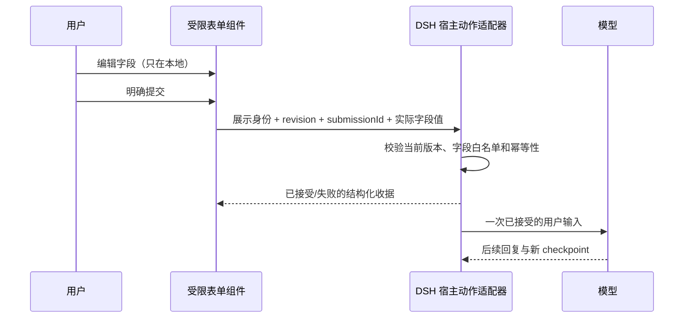

# 采用记录与后续实现合同

22的[最终分层接受](../evidence/source-workflow.json)已补齐：371文件归档、macOS/Linux Native/PTC与旧图恢复、普通答复正反例及四匿名资产分别核验。明确给定失败规则可核，原始模型正文仍不认证；旧研究与自然失败范围不重写。

preview.22已交付继续落实来源、结构和解释分离：[完整workflow失败规则](../SOURCE-WORKFLOW.zh-CN.md)要求四拓扑之外的明确失败分支、retry-only与no-rollback完整映射；普通render从同一来源重建约束和说明，不能靠正确箭头认证故障传播。候选开发检查与最终包分层；旧A2自然错误和世界/正文未核保持，没有新上游依赖或协议适配宣称。

preview.21已交付，进一步吸收“只读状态与明确执行分开”的生命周期原则：[冷来源补充](../COLD-SOURCE-UPDATE.zh-CN.md)复用原生投影、Session resolver、命令/Peer/prompt与原ID收据；归档、排队和有自动任务历史的会话不会由此入口恢复。开发构建和最终归档分开记录；最终365文件归档的macOS/Linux Native/PTC、实际组件无ID反例及四匿名资产已[单独接受](../evidence/cold-source-update.json)。未引入AG-UI/A2UI适配器、新图表引擎或第二会话库，不把这项窄闭环算作通用表单完成。

后续[新来源快照的两个真实模型观察](../CODEX-SOURCE-UPDATE.zh-CN.md)分别核工具采用和原始正文：unknown保留，新false选择反向else→need true，首次view比较matched，raw有限判据评读met。来源/宿主/模型仍分层，静态导入不冒实时回调或通用提交完成；没有新上游复制、runtime依赖或发行，原矩阵不回写。

preview.19把此前A2UI/assistant-ui/Tambo启发的本地编辑、明确提交、接收与采用分层落实到[一个未知布尔事实补充](../SOURCE-UPDATE.zh-CN.md)。复用原DSH日志/Peer/正常prompt，不新建会话库；实际能力仍窄于候选RequestForm合同，任意字段/通用表单/结果迁移不宣称完成。

preview.17进一步落实“声明、条件、实际交付分开”：[显式两分支来源](../SOURCE-CONDITIONAL.zh-CN.md)保留条件/分支出处并归一化当前需求，复用同core/renderer；完整普通入口、归档Native/PTC与2次新模型原文分别验证。条件unknown不等false、能力true不等整体推荐，没有新图表引擎或外部依赖。原preview.11矩阵与首次失败不回写，当前采用仍不足以全面替代GenUI的提交闭环/可迁移产物。

对应研究：[交互 UI 研究](README.md)、[固定来源](projects.json)。本次吸收设计与语义，不复制上游组件源码、不新增候选库的运行依赖，不宣称实现其协议兼容。

2026-10-27 按 preview.11 重新对照代码与分版本验收，见 [采用复核](ABSORPTION-AUDIT.zh-CN.md) 和 [本轮来源快照](absorption-audit.json)。下文保留各轮采用记录；当前实现已包含协议1.4角色/关系与预期作用检查、同表格范围的缺失值对照，仍不认证来源或自由正文。下一步优先来源/正文一致性，再实现有界提交；后续图种和完整交互产物继续作为候选。

同日后续的本地 preview.12-dev.0 增加 [显式来源关系核对](../SOURCE-CHECKS.zh-CN.md)：通过请求外的启动文件快照与所选箭头片段进行内容对照。仅此语法子集已有实际功能；来源作者与任意正文仍未认证。上面的preview.11矩阵、固定上游快照、历史ARIA修复及原自然失败不因此改写。

preview.12-dev.1继续增加 [普通比较来源核对](../SOURCE-DECISION.zh-CN.md)：有限中文语法可以直接处理保留D1问题中的维护责任、当前需求与未知，对照实际字段及要求方向。它不将供应商更新推成团队无需维护，也不把偏好变成硬需求；仍未认证任意自然语言、正文或作者，未完成通用P0/P1。

preview.12继续将完整decision-zh接入同一个 [正常render与保存](../SOURCE-DELIVERY.zh-CN.md)。它吸收“来源、状态与显示分离”的原则，以来源核对后的投影替换模型注释；本地what-if仍是明确假设。只解决有限语法与当前输入，不冒充自由正文认证或P1提交闭环。

preview.15进一步落实统计来源与绘制分离：[数值来源绑定](../SOURCE-NUMERIC.zh-CN.md) 在MCP启动快照上核对每位置值/缺失mask/单位和observed/complete均值分母，并实际进入普通零推理答复。同均值填零也会被拒绝；来源身份、自由正文、新DSH数值源、提交闭环与结果迁移仍未完成。它复用现有统计核心与DataChart，没有新增图表引擎或移植候选项目代码。14候选的空白解析超时及15修复按 [独立证据](../evidence/source-numeric.json) 保留。

preview.16进一步将同一数值来源约束接入 [正常DSH交付](../NUMERIC-DELIVERY.zh-CN.md)：完整当前输入→逐字段核对→新来源投影→保存/刷新，原始统计范围与本地探索分开。最终归档的本机/Linux Native/PTC正反例有独立证据，依旧0真实模型；不是任意语言或正文认证，也没有表单闭环/结果迁移。

之后复用16归档的[两个新Codex合成样本](../CODEX-NUMERIC-OBSERVATION.zh-CN.md)进一步观察模型采用：来源与普通问题分开，两次均有真实source工具调用及同回合修正，原候选区分实测、完整未知和合法补零假设。初次比较均拒绝，宿主canonical未覆盖B假设计算；两题人工评读通过不等于自动正文认证。观察后澄清通用坐标指引仅离线检查，没有第三次模型或新运行依赖/发行。

初版[显式宿主假设答复](../CODEX-ZERO-FILL.zh-CN.md)将“来源/假设/计算分开”落到普通stdout：C完整source比较后复用已有统计核心交付假设值，D首次partial及未完成数学目标保留；后续修复另列下段。没有新图表引擎、算术核心或模型观察，也不改变旧B结果、提交闭环与结果迁移缺口。

D后续修复进一步明确范围：保留原source匹配结果，独立假设副本由同一核心计算0；副本的完整已知及内部差值不转移给原来源。只回归失败D、16离线合同、0模型，原partial和数学预期不变；无需引入新图表库或核心改版。

## 已进入本仓库的实现

| 采用点 | 来源启发 | 实际实现 | 验证边界 |
|---|---|---|---|
| 显式能力目录 | A2UI catalogs、AG-UI discovery、组件词汇表 | `src/capabilities.ts`；同一工具 `action=catalog` 返回三组件、需要的数据、本地操作与未实现能力 | 不查询/推断其它插件，不是协议转换器；表单回传和探索控件状态持久化仍为 false；个人模板能力单独列出 |
| 比较结果可核对 | 有类型的工具结果、状态与展示分离 | `src/facts.ts` 的 decisionFacts；返回初始条件下的状态、候选、待定规则、缺失条件和声明来源计数 | 只是已声明规则求值；仍不证明模型规则、来源或事实正确 |
| 图表可访问状态 | ECharts 的显式 ARIA 模块与等价数据 | `src/components/DataChart.tsx` 注册 AriaComponent；描述包含当前范围、有效/缺失量，随系列/范围更新 | 真实浏览器核对可访问标签，不冒充真实屏幕阅读器或手机验收 |
| 可维护的选型来源 | 不把框架、协议、控件、图表引擎混为一谈 | projects.json + 派生 PROJECTS；`scripts/research-check.mjs` 检查固定 commit、许可证、采用路径和派生一致性 | 本地校验记录完整性，不自动证明上游仍维护或功能运行正常 |

**历史修复（2026-10-23，preview.5）**：preview.4 的 DataChart 设置了 `aria.enabled`，但没有注册对应模块；preview.5 在提交 `17eed6c` 中补充 `AriaComponent` 注册。可对照 [preview.4 源码](https://github.com/WhyTan00/dsh-semantic-ui/blob/v0.1.0-preview.4/src/components/DataChart.tsx) 与 [preview.5 源码](https://github.com/WhyTan00/dsh-semantic-ui/blob/v0.1.0-preview.5/src/components/DataChart.tsx)。该轮模型侧原则也更新为：目录外按实际可用能力选择，不把 GenUI 或任意品牌当通用 fallback，不承诺本地控件能回传或跨刷新保存。

2026-10-27 的 9 项目 / 16 文件采用复核仅更新文档与来源快照，没有再次修改 ARIA 实现或新增运行功能；历史验证仍按原版本保留。

## 真实模型定向复核

preview.5 的四个新会话保留全部首次结果：能力题实际调用 catalog，两个比较题收到 decisionFacts，报名表使用可用 GenUI。共 25 次模型请求；能力题另检查了已安装公开包的源码，不把它当低成本路由基准。两个比较正文仍有过强倾向或不成立的附加解释，说明回执不能强制模型推理正确。

报名表填写后等待 1000ms 再刷新，主题和备注实际保留；但正文承诺“只填备注也能提交”，按钮实际禁用。先前 C4 是另一生成实例与不同刷新时序，不能由其中一个样例推断全部 GenUI 控件持久化。首次记录、原输入摘要和实际浏览器检查见 [定向证据](../evidence/ecosystem-adoption.json)。这不是新的完整 11 题轮次，也不改变本插件尚无表单回传的事实。

## 明确不采用

- 不复制缺失点补零、把统计图当装饰图的容错。null/0、空箱、时间间隔与分母继续由自有协议/纯函数约束。
- 不为节省厂商宣称的 token 数切换 DSL。先测同题、同模型、首次结果与完整工具成本；目前没有该对照证据。
- 不因为上游支持 state 就平行增加会话库。内容仍由 DSH checkpoint 保存，探索控件临时状态仍复位；个人模板单独保存。
- 不把完整 ECharts/Vega/JS 配置交给模型；不隐式开放自定义函数、网络数据或应用脚本。
- 不引入已归档 Tool UI 作为默认新依赖，不把源码 HEAD 的 canary/private 版本当稳定安装版本。
- 不把 SurveyJS 商业产品或 MCP Apps 文档/历史代码的许可概括成统一 MIT。本次没有移植相关代码。

## preview.6 已实现：个人模板与受限主题

原候选合同已进入 preview.6 实现：`src/templates.ts`、`theme.ts`、原生 owner RPC/storageDomain 与三组件主题层。使用和实际边界见 [模板说明](../TEMPLATES.zh-CN.md)。preview.5 不包含该能力。先让已有三组件中满意的表达能被命名保存、预览、修改并在新会话换数据复用，再接入下节的表单反馈。产品理由和与模型记忆的关系见 [MODEL-PROGRESS](MODEL-PROGRESS.zh-CN.md)。

实现分开四种对象（本版不保存任何决策规则）：

| 对象 | 保存内容 | 边界 |
|---|---|---|
| 偏好 | 默认主题（含密度、字号）；默认模板引用留待后续 | 可由用户修改/删除；模型推测仅作为提案 |
| 主题 | 有类型、受限的颜色、字体族、字号、间距等参数 | 禁止任意 CSS/脚本/远程资源；校验可读性，不允许隐藏必要语义说明 |
| 模板 | 稳定 ID/版本、组件种类、所需输入与显示配置（本版不保存规则） | 不携带上次的真实数据、备注、来源声明或计算结论；规则须区分可复用偏好与一次性事实 |
| 生成实例 | 当次输入、来源/假设、模板版本、实际主题参数和计算结果 | 由 DSH checkpoint 保存；保持现有旧历史可读，不能靠模板当前值重写过去 |

保存时展示“哪些保留、哪些下次提供”的预览。模型建议模板改动时先产生新版本预览，已保存版本不会被静默覆盖；用户可复制、回退、删除、导出/导入。切换主题不改变数据、单位、规则与求值结果。模板不兼容当前组件或缺必需输入时明确提示，允许改用普通表达；不得默默填入旧实例的数值和结论。

个人模板库使用宿主私有存储，以 profile 名称分隔 domain，独立于源码 Git；它只维护模板对象，DSH 继续拥有会话记录。公开宿主接口与已验证适配见 [TEMPLATES](../TEMPLATES.zh-CN.md)，不修改共享账号、路由或会话机制。导出只包含明确选择的模板/主题定义与示例；当次真实数据快照应另行选择，不能因分享模板连带导出。模板中人类可读说明只作为展示/表达偏好，不能升级为工具授权或覆盖宿主规则。

主题层借鉴 [DTCG](https://www.designtokens.org/) 的有类型设计变量与交换方向、[A2UI theming](https://a2ui.org/guides/theming/) 的 renderer 负责呈现原则。当前不宣称 DTCG 格式兼容；若实现导入，仅声明经过测试的类型子集，并对未知类型报错。A2UI 文档也明确基本目录尚未接通模型传入的 theme，不能把协议有字段当成实际支持。没有引入新的图表/主题框架；宿主存储与连接服务显式声明为同版本 peers，Zod 对齐宿主的 4.4.3。

验收应至少覆盖：新会话换数据复用、缺字段/类型错误、保存后重启恢复、同输入/同版本得到相同语义结果、主题变更不改变事实、更新/回退/删除、旧历史恢复、模板导入错误/版本不兼容、导出不含上一实例的私有数据、窄屏和键盘操作。源码中的硬编码 CSS 和图/图表色值需要一并梳理，不能只改容器颜色就称完整主题支持。同一版本的语义一致性不等于跨设备像素完全一致。

首批范围不包含任意多组件页面编排、通用拖拽编辑器、代码模板、云同步或商城；先用真实的重复任务检验模板是否减少第二次使用的工作量。

## 随后接入：有界 RequestForm

这是一份候选实现合同，**本版本未实现表单、用户动作回传或草稿保存**。它比一次性增加许多卡片/图种更能解决缺失条件问题，也能让目录外能力逐步由本项目承担。

第一阶段只需要有限字段：文本、单选、多选、数值与显式 unknown。字段含稳定 ID、label、必填/范围/选项；schema 与显示提示分离。错误定位到字段，保留已填值，键盘可用；模型默认值与用户真实提交不能混为一谈。暂不含文件、外部 URL、自定义表达式或任意 action。

建议的数据流：

动作仅由宿主注册的处理器执行。模型给出的动作名不是授权；受限表单先只产生正常用户输入，不允许直接执行外部操作。编辑不发模型请求，提交才进入反馈环路。字段收集保留 false、0、空数组与缺失的区别；未选择不等于否定。

收据建议包含 `(session, turn, displayId, revision, actionId, submissionId)` 身份、接受状态及有界字段摘要。重复点击不重复开启模型回合；旧 revision 不能悄悄作用于新表单。失败时能重试并沿用同一 submissionId，取消和中断有清楚状态。不要把浏览器点击成功写成宿主已接受。

持久化分三层验证：组件内容来自 DSH；未提交草稿默认本地且刷新复位；已提交收据需要宿主日志支持。只有实际实现并验证后，才分别打开 capability 标志。不得使用第二套聊天库或上游不支持的必需自定义事件，也不改写旧 GenUI 历史。具体公开 RPC/事件适配尚待实现前核实。

验收至少覆盖空/缺失/false/0、多选、字段错误、双击、旧 revision、取消、服务重启、历史只读恢复、Native/PTC 与两个生成插件同时开启时的表达选择。现有 GenUI 报名表的刷新承诺失败和真实提交记录是负例/基准，不能用它冒充我们的 RequestForm 已完成。

## 其它候选的进入条件

| 优先顺序 | 能力 | 进入实现前需要解决的具体问题 |
|---|---|---|
| preview.6 已实现 | 个人模板、受限主题与版本管理 | 保存满意结果并换数据复用；定义、实例与历史责任清楚，隐私与兼容验证通过 |
| 随后接入 | 缺失条件表单与动作收据 | 上述宿主接受/幂等/状态合同；实际解决比较任务的关键输入缺口 |
| 按真实任务采用 | 更强 DataTable、步骤/进度与引用 | 显示值和源数据一致；排序/筛选不改变事实；动作与展示分开 |
| 按统计需求采用 | 散点、误差区间、分面/关联选择 | 声明样本、统计方法和选择范围；误差条不自动变成置信区间；renderer 可替换 |
| 按图复杂度采用 | ELK/G6/Cytoscape | 嵌套、端口或分析需求出现；规模、交互可读性与许可证实际验证 |
| 后置 | 地图、3D、生成应用 | 输入领域语义、资产与运行边界、宿主适配、设备资源与真实收益 |

保持可替换 renderer：语义载荷描述“要表达的关系/数据/交互”，可信适配器编译为具体库配置。对外 capability 必须与已实现代码、公开类型、文档和实测一致；研究候选不出现在当前 supported 列表里。

## preview.7：把来源原则落到图形与操作

新增 Unovis、Visa Chart Components 的固定源码研究，并补充 Observable Plot 时间尺度、React Flow 键盘选择和 ECharts ARIA 实现来源，合计 35 项/139 份文件。时间几何、稳定颜色与纹理、等价表格/下载、非拖拽节点查看和包含自环的窄屏视口已独立实现；没有把上游组件代码整包吸入，也没有新增运行依赖。具体改变、来源、测试与未验证边界见 [质量改进](../QUALITY.zh-CN.md)。
