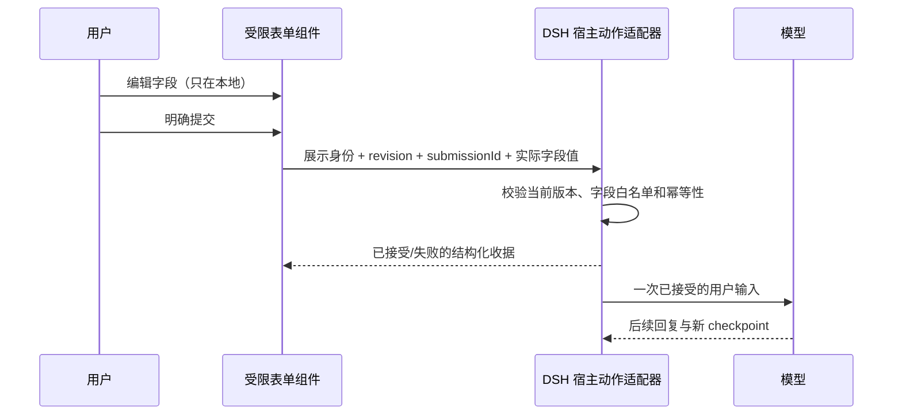

# 采用记录与后续实现合同

对应研究：[交互 UI 研究](README.md)、[固定来源](projects.json)。本次吸收设计与语义，不复制上游组件源码、不新增候选库的运行依赖，不宣称实现其协议兼容。

## 已进入本仓库的实现

| 采用点 | 来源启发 | 实际实现 | 验证边界 |
|---|---|---|---|
| 显式能力目录 | A2UI catalogs、AG-UI discovery、组件词汇表 | `src/capabilities.ts`；同一工具 `action=catalog` 返回三组件、需要的数据、本地操作与未实现能力 | 不查询/推断其它插件，不是协议转换器；无模型回传/偏好持久化的标志为 false |
| 比较结果可核对 | 有类型的工具结果、状态与展示分离 | `src/facts.ts` 的 decisionFacts；返回初始条件下的状态、候选、待定规则、缺失条件和声明来源计数 | 只是已声明规则求值；仍不证明模型规则、来源或事实正确 |
| 图表可访问状态 | ECharts 的显式 ARIA 模块与等价数据 | `src/components/DataChart.tsx` 注册 AriaComponent；描述包含当前范围、有效/缺失量，随系列/范围更新 | 真实浏览器核对可访问标签，不冒充真实屏幕阅读器或手机验收 |
| 可维护的选型来源 | 不把框架、协议、控件、图表引擎混为一谈 | projects.json + 派生 PROJECTS；`scripts/research-check.mjs` 检查固定 commit、许可证、采用路径和派生一致性 | 本地校验记录完整性，不自动证明上游仍维护或功能运行正常 |

旧 DataChart 的 `aria.enabled` 没有对应模块注册，选项本身不能生效；本轮按公开引擎要求修复。模型侧原则同时更新：目录外按实际可用能力选择，不把 GenUI 或任意品牌当通用 fallback，不承诺本地控件能回传或跨刷新保存。

## 真实模型定向复核

preview.5 的四个新会话保留全部首次结果：能力题实际调用 catalog，两个比较题收到 decisionFacts，报名表使用可用 GenUI。共 25 次模型请求；能力题另检查了已安装公开包的源码，不把它当低成本路由基准。两个比较正文仍有过强倾向或不成立的附加解释，说明回执不能强制模型推理正确。

报名表填写后等待 1000ms 再刷新，主题和备注实际保留；但正文承诺“只填备注也能提交”，按钮实际禁用。先前 C4 是另一生成实例与不同刷新时序，不能由其中一个样例推断全部 GenUI 控件持久化。首次记录、原输入摘要和实际浏览器检查见 [定向证据](../evidence/ecosystem-adoption.json)。这不是新的完整 11 题轮次，也不改变本插件尚无表单回传的事实。

## 明确不采用

- 不复制缺失点补零、把统计图当装饰图的容错。null/0、空箱、时间间隔与分母继续由自有协议/纯函数约束。
- 不为节省厂商宣称的 token 数切换 DSL。先测同题、同模型、首次结果与完整工具成本；目前没有该对照证据。
- 不因为上游支持 state 就平行增加会话库。内容仍由 DSH checkpoint 保存，本地偏好仍按当前合同复位。
- 不把完整 ECharts/Vega/JS 配置交给模型；不隐式开放自定义函数、网络数据或应用脚本。
- 不引入已归档 Tool UI 作为默认新依赖，不把源码 HEAD 的 canary/private 版本当稳定安装版本。
- 不把 SurveyJS 商业产品或 MCP Apps 文档/历史代码的许可概括成统一 MIT。本次没有移植相关代码。

## 下一步首选：有界 RequestForm

这是一份候选实现合同，**本版本未实现表单、用户动作回传或草稿保存**。它比一次性增加许多卡片/图种更能解决缺失条件问题，也能让目录外能力逐步由本项目承担。

第一阶段只需要有限字段：文本、单选、多选、数值与显式 unknown。字段含稳定 ID、label、必填/范围/选项；schema 与显示提示分离。错误定位到字段，保留已填值，键盘可用；模型默认值与用户真实提交不能混为一谈。暂不含文件、外部 URL、自定义表达式或任意 action。

建议的数据流：

动作仅由宿主注册的处理器执行。模型给出的动作名不是授权；受限表单先只产生正常用户输入，不允许直接执行外部操作。编辑不发模型请求，提交才进入反馈环路。字段收集保留 false、0、空数组与缺失的区别；未选择不等于否定。

收据建议包含 `(session, turn, displayId, revision, actionId, submissionId)` 身份、接受状态及有界字段摘要。重复点击不重复开启模型回合；旧 revision 不能悄悄作用于新表单。失败时能重试并沿用同一 submissionId，取消和中断有清楚状态。不要把浏览器点击成功写成宿主已接受。

持久化分三层验证：组件内容来自 DSH；未提交草稿默认本地且刷新复位；已提交收据需要宿主日志支持。只有实际实现并验证后，才分别打开 capability 标志。不得使用第二套聊天库或上游不支持的必需自定义事件，也不改写旧 GenUI 历史。具体公开 RPC/事件适配尚待实现前核实。

验收至少覆盖空/缺失/false/0、多选、字段错误、双击、旧 revision、取消、服务重启、历史只读恢复、Native/PTC 与两个生成插件同时开启时的表达选择。现有 GenUI 报名表的刷新承诺失败和真实提交记录是负例/基准，不能用它冒充我们的 RequestForm 已完成。

## 其它候选的进入条件

| 优先顺序 | 能力 | 进入实现前需要解决的具体问题 |
|---|---|---|
| 先做 | 缺失条件表单与动作收据 | 上述宿主接受/幂等/状态合同；实际解决比较任务的关键输入缺口 |
| 按真实任务采用 | 更强 DataTable、步骤/进度与引用 | 显示值和源数据一致；排序/筛选不改变事实；动作与展示分开 |
| 按统计需求采用 | 散点、误差区间、分面/关联选择 | 声明样本、统计方法和选择范围；误差条不自动变成置信区间；renderer 可替换 |
| 按图复杂度采用 | ELK/G6/Cytoscape | 嵌套、端口或分析需求出现；规模、交互可读性与许可证实际验证 |
| 后置 | 地图、3D、生成应用 | 输入领域语义、资产与运行边界、宿主适配、设备资源与真实收益 |

保持可替换 renderer：语义载荷描述“要表达的关系/数据/交互”，可信适配器编译为具体库配置。对外 capability 必须与已实现代码、公开类型、文档和实测一致；研究候选不出现在当前 supported 列表里。
